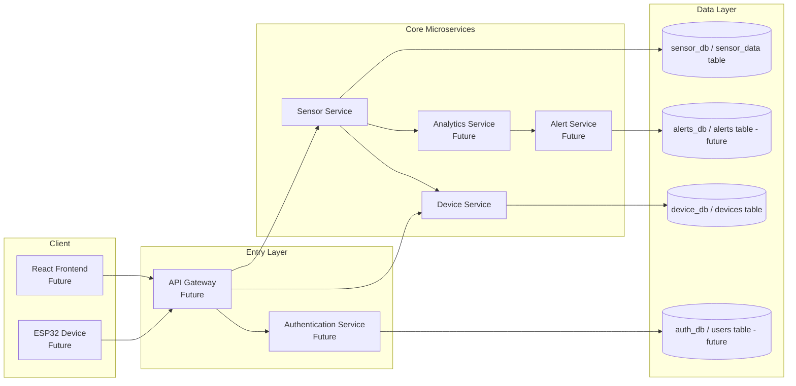

# Smart Weather & Air Quality Monitoring Platform – Architecture (Phase 1 Foundation)

## 1) System Overview

This platform is a cloud-native IoT backend for ingesting and monitoring environmental telemetry (temperature, humidity, air quality, pressure, rain) from edge devices (ESP32 in future phases).  
Phase 1 focuses on production-style backend foundations using Spring Boot microservices and PostgreSQL.

## 2) Overall Architecture Diagram

## 3) Microservice Responsibilities

- **API Gateway (future):** single entry point, routing, rate limiting, auth token forwarding/validation.
- **Authentication Service (future):** user registration/login, JWT issuance, role-based access controls.
- **Device Service:** device registration, device metadata management, lifecycle status updates.
- **Sensor Service:** ingest sensor readings, query latest values, query historical values.
- **Analytics Service (future):** trend analysis, anomaly detection, aggregation pipelines.
- **Alert Service (future):** threshold/rule-based alert generation and notification orchestration.
- **React Frontend (future):** dashboards, telemetry charts, device control and administration UI.

## 4) Database Architecture

Pattern: **Database-per-Service**.

- Device Service owns `devices` in `device_db`.
- Sensor Service owns `sensor_data` in `sensor_db`.
- Future: Alert Service owns `alerts`; Auth Service owns `users`.

Cross-service relationships use `device_uid` correlation, not cross-database foreign keys.

## 5) Communication Patterns

- **Phase 1:** synchronous REST calls.
- **Future:** asynchronous eventing (Kafka/SQS) for decoupled analytics/alerts.

## 6) Request Flow (Phase 1)

1. Client/device sends request.
2. (Future) API Gateway routes request to target service.
3. Service validates payload and business constraints.
4. Service persists/retrieves data from its own database.
5. Service returns standardized JSON response.

## 7) Data Flow (Phase 1 and Future)

- **Phase 1:** ESP32/client → Sensor Service → `sensor_data`.
- **Future:** Sensor data event → Analytics Service → Alert Service → user notifications and dashboards.

## 8) Future AWS Deployment Architecture

- Compute: AWS ECS Fargate (per-service task definitions).
- Traffic: Application Load Balancer.
- Images: Amazon ECR.
- Data: Amazon RDS for PostgreSQL.
- Observability: CloudWatch logs/metrics.
- Security: IAM task roles + Secrets Manager/Parameter Store.

## 9) Future IoT Integration

- ESP32 publishes telemetry (MQTT/HTTPS).
- AWS IoT Core (future option) receives device messages.
- IoT rule routes telemetry into Sensor Service ingestion path.

## 10) Technology Stack

- Java 21
- Spring Boot 3.4.1
- Spring Web, Spring Data JPA, Validation, Lombok, DevTools
- PostgreSQL 16
- Maven

## 11) Key Architectural Decisions

1. **Database-per-Service:** loose coupling and independent schema evolution.
2. **REST-first in Phase 1:** simple, observable, and easy to test baseline.
3. **`device_uid` as correlation key:** microservice-friendly linkage without tight DB coupling.
4. **Gateway-first external access model (future):** centralized cross-cutting concerns.
